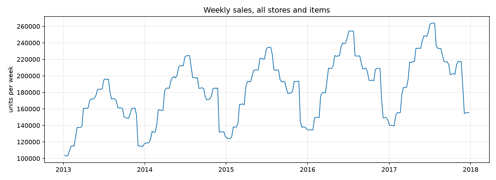
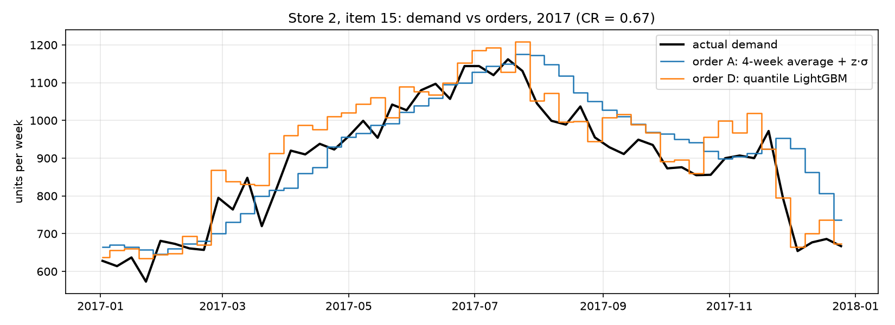
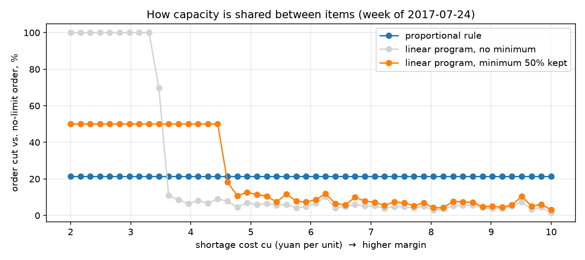
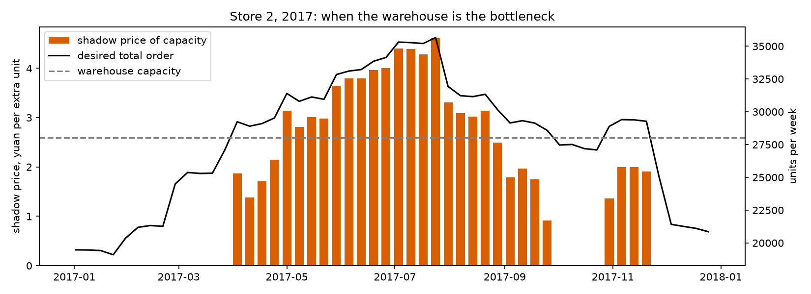
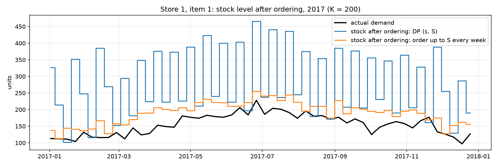

# 基于需求预测的库存订货决策 | From Forecast to Order

**作者：** 林乐思（Balabanov Oleksii）· 个人项目，2026 年 11 月
**工具：** Python、pandas、LightGBM、SciPy、PuLP + HiGHS
**PDF 版：** [下载 PDF 报告](report/forecast_to_order_report.pdf)（内容与本页相同）

门店每周都要决定订多少货。订少了，顾客买不到，门店少赚钱；订多了，卖不掉的货要亏本处理。我用一份公开的零售数据，把这件事拆成两步：先预测下周能卖多少，再用运筹学方法决定订多少；最后用 2017 年的真实销量检验每种做法实际会损失多少钱。

本页写的是每一部分的思路、一个小例子和主要结果。完整代码、中间结果和全部图表在 `notebooks/` 里，每一节标题后写了对应的文件名；图表也单独保存在 `figures/` 里。

## 主要结论

1. 用 LightGBM 预测、再按报童模型订货，2017 年的总损失比“过去 4 周平均”法低约 15%。
2. 报童模型默认预测没有系统性偏差。在这份数据里，LightGBM 对 2017 年的需求平均高估了约 10 件/周，这时再加安全库存，损失反而比直接按预测订货更高。
3. 在我假设的仓库容量和商品利润下，线性规划比“所有商品按同一比例削减”少损失约 12%。
4. 在我假设的运费下（每次 200 元），动态规划找到的 (s, S) 策略比“每周都补货”少损失约 8%，每年订货次数从 52 次减到 39 次。

## 研究问题

1. 预测更准，能让订货决策少损失多少钱？
2. 仓库放不下所有想订的货时，应该先削减哪些商品？
3. 卖不完的货可以留到下周、每次订货又要付运费时，应该多久订一次，每次订多少？

## 数据

我使用 Kaggle 上的公开数据集 [Store Item Demand Forecasting Challenge](https://www.kaggle.com/c/demand-forecasting-kernels-only/data)：10 家门店、50 种商品，2013 年到 2017 年每天的销量，共 913,000 条记录。我检查过，数据没有缺失值，也没有负销量，每个“门店 × 商品”组合都有完整的 1826 天。

因为订货每周做一次，我把日销量加总成周销量。2013 年 1 月 1 日是星期二，第一周只有 6 天，会让这一周的销量偏低，所以我删掉了这一周，剩下 260 周。

我按时间顺序把数据分成三段：2013–2015 年（156 周）用来训练模型，2016 年（52 周）用来选择参数和估计预测误差，2017 年（52 周）只在最后用来检验结果。不按时间顺序随机划分的话，模型训练时就会看到“未来”的数据，检验结果会偏好，这种情况叫数据泄露。

从图上能看出两点：销量逐年增长，年度最高周销量从 2013 年的约 19.6 万件涨到 2017 年的约 26.3 万件；每年 7 月（第 26 至 30 周）是销售高峰，12 月明显下降。



数据文件没有上传到本仓库。运行代码前，请从 Kaggle 下载 `train.csv`，放到 `data/` 目录。

## 方法与结果

### 1. 需求预测（`02_forecast.ipynb`）

我比较了三种预测下周销量的方法。三种方法都只用上周及更早的数据。

| 方法 | 做法 | 例子 |
| --- | --- | --- |
| A. 移动平均 | 用过去 4 周销量的平均值 | 过去 4 周卖了 90、100、110、100 件，预测 (90 + 100 + 110 + 100) / 4 = 100 件 |
| B. 季节性朴素法 | 用去年同一周的销量 | 去年第 27 周卖了 120 件，今年第 27 周就预测 120 件 |
| C. LightGBM | 一种梯度提升树模型：依次训练几百棵小决策树，每棵树修正前面所有树的误差 | 见下文 |

方法 C 有一个处理需要说明。决策树给出的预测值不会超过训练数据里出现过的范围，但这份数据的销量每年都在涨，2017 年的销量比 2013–2015 年都高，直接预测销量会系统性偏低。所以我让模型预测“今年销量是去年同一周的几倍”，再乘回去年的销量。例如去年同一周卖了 100 件，模型预测倍数是 1.08，预测值就是 108 件。这个倍数不会随着年份一直变大：每年各周的中位数在 1.04 到 1.15 之间，模型更容易学。模型用到的信息有：最近 4 周比去年同期高多少、这是一年中的第几周、几月、哪家门店、哪种商品。

我用两个指标评价预测：

- MAE（平均绝对误差）：每个预测与实际销量之差取绝对值，再求平均。例如两次预测都是 100，实际分别卖了 110 和 94，误差是 10 和 6，MAE = (10 + 6) / 2 = 8 件。MAE 越小，预测越准。
- 平均偏差：误差保留正负号再求平均（预测 − 实际）。同一个例子里，误差是 −10 和 +6，平均偏差 = (−10 + 6) / 2 = −2 件，说明略微低估。正负误差会互相抵消，所以平均偏差只说明预测整体偏高还是偏低，不说明误差有多大。

2017 年测试结果：

| 方法 | MAE（件/周） | 平均偏差（件/周） |
| --- | --- | --- |
| A. 移动平均 | 30.8 | −0.7 |
| B. 季节性朴素法 | 25.6 | −15.1 |
| C. LightGBM | 24.8 | +9.7 |

计算方法：测试集是 2017 年 52 周 × 500 个“门店 × 商品”组合，共 26,000 个预测。表中的数字是这 26,000 个误差的平均值。LightGBM 的特征和参数在看到 2017 年结果之前就已经固定，只参考了 2016 年的结果；之后我用 2014–2016 年的数据重新训练一次，在 2017 年上只计算一次，没有再根据 2017 年的结果做调整。

方法 B 只是重复去年的销量，没有考虑一年来的增长，所以平均每周少估 15 件。LightGBM 是在增长较快的 2014–2016 年上训练的，而 2017 年增长放缓（同一周销量与上一年之比的中位数，2016 年是 1.08，2017 年只有 1.04），所以它平均每周多估了约 10 件。

### 2. 报童模型（`03_newsvendor.ipynb`）

报童模型讲的是：一个报童每天早上进报纸，进少了少赚钱，进多了晚上只能低价处理，他应该进多少？我把它用在每个“门店 × 商品”的每一周上。数据里没有价格，所以我假设：

- 售价 10 元，进价 4 元，卖不掉的每件只能按 1 元处理；
- 缺 1 件少赚 10 − 4 = 6 元，多 1 件亏 4 − 1 = 3 元；
- 临界比率 CR = 6 / (6 + 3) ≈ 0.67。意思是订货量应该让大约 67% 的周不缺货。缺货比剩余贵一倍，所以宁可多订一点。

订货量 Q = μ + z·σ。其中 μ 是预测值；σ 是这个“门店 × 商品”在 2016 年预测误差的标准差，也就是预测通常会错多少件；z 是标准正态分布里让 67% 的面积落在左边的那个点，等于 0.43。z·σ 这部分就是“安全库存”，用来应对预测可能偏低的情况。这个公式成立的前提是预测误差近似正态分布，而且平均为 0。

例子：1 号门店 1 号商品 2017 年第一周，预测 112 件，σ = 18.6 件，订货量 Q = 112 + 0.43 × 18.6 ≈ 120 件。实际卖了 113 件，剩 7 件，损失 7 × 3 = 21 元；如果实际卖了 130 件，就缺 10 件，损失 10 × 6 = 60 元。

我还试了方法 D：分位数 LightGBM。普通模型预测的是“中间值”，分位数模型可以直接预测“67% 的情况下需求不会超过多少”，这个数就是订货量，不需要另外计算 σ 和 z。

2017 年测试结果：

| 订货方法 | 总损失（千元） | 损失相当于 A 的 | 不缺货的周数占比（目标 66.7%） |
| --- | --- | --- | --- |
| A：移动平均 + 报童公式 | 3159.5 | 100.0% | 64.4% |
| B：季节性朴素法 + 报童公式 | 2762.2 | 87.4% | 47.7% |
| C：LightGBM + 报童公式 | 2670.3 | 84.5% | 78.9% |
| C：LightGBM，直接按预测订货 | 2523.5 | 79.9% | 63.3% |
| D：分位数 LightGBM | 2698.8 | 85.4% | 78.3% |



计算方法：每种方法都对 2017 年的 26,000 个“周 × 门店 × 商品”分别算出订货量，再和当周的实际销量比较，算出缺货损失（缺的件数 × 6 元）和剩余损失（多的件数 × 3 元），最后把 26,000 个损失加起来。“不缺货的周数占比”是订货量不少于实际销量的那部分所占的比例。σ 只用 2016 年的误差计算。

从结果里能看出几点：

- 方法 A 的预测几乎没有偏差，它不缺货的比例是 64.4%，和公式的目标 66.7% 很接近。
- LightGBM 本来就高估了需求，再加上安全库存，货就订多了：不缺货的比例到了 78.9%，剩余损失变大。所以在这份数据里，“C + 报童公式”反而比“C 直接按预测订货”损失更多。不过“直接按预测订货”更好这一点，是看到 2017 年的结果以后才知道的，所以我没有把它当作最终方法。
- MAE 不区分高估和低估，但在这个设定里缺货比剩余贵一倍，误差的方向也会影响损失。所以评价订货方法要看损失金额，不能只看预测误差。
- 价格是我假设的，所以我又试了 CR = 0.5、0.8、0.9 三种情况（固定剩余成本 3 元，改变缺货成本）。四种情况下各方法从好到差的顺序都一样。CR = 0.5 时方法 C 和 D 的结果完全相同，这是因为此时 z = 0，方法 C 就是按预测订货；方法 C 用 MAE 作为训练目标，预测的是需求的中位数；α = 0.5 的分位数模型预测的也是中位数，而且它的训练目标正好是 MAE 的一半，所以两种方法训练出的是同一个模型。两条路得到同一个结果，也说明代码没有算错。

### 3. 仓库容量有限：线性规划（`04_capacity_lp.ipynb`）

前面每种商品都是单独决定订货量的。实际上一家门店的仓库只能放这么多货。这一部分以 2 号门店的 50 种商品为例。数据里没有仓库容量，也没有每种商品的利润，所以我做了三个假设：

- 仓库最多放 28,014 件，即 2016 年平均每周需求的 1.1 倍；
- 不同商品的利润不同，缺 1 件的损失从 2 元（1 号商品）到 10 元（50 号商品）不等，多 1 件都亏 3 元；
- 每种商品至少要保留原本想订数量的一半（我把它叫作“最低陈列量”），因为门店一般不会让某种商品完全断货。

在这些假设下，2017 年有 30 周仓库放不下所有想订的货。这时我比较两种做法：一种是所有商品按同一比例削减；另一种是用线性规划决定每种商品削减多少。

线性规划需要知道下周需求可能是多少。我没有假设需求服从某种分布，而是直接用 2016 年的真实预测误差造出 52 种可能的情况（情景）：情景 k = 本周的预测 + 2016 年第 k 周模型的预测误差。例如本周预测 400 件，2016 年第 3 周模型少估了 25 件，情景 3 就是 425 件。这种用一组样本情景代替整个概率分布的方法叫样本平均近似（SAA）。

线性规划的目标是让 52 个情景的平均损失最小，约束是 50 种商品的订货量加起来不超过仓库容量，并且每种商品不低于最低陈列量。损失里的“缺货件数”是 max(需求 − 订货量, 0)，这不是线性函数。我为它引入一个辅助变量 u，要求 u ≥ 需求 − 订货量、u ≥ 0。u 在目标函数里有成本，求解器会把它压到最小，最后 u 正好等于缺货件数，整个问题仍然是线性规划。每周的模型有 5,250 个变量，用免费的 HiGHS 求解器不到一秒就能解完。

| 方法 | 2017 年总损失（千元） |
| --- | --- |
| 仓库不限容量（只作参照） | 309.4 |
| 所有商品按同一比例削减 | 532.2 |
| 线性规划（有最低陈列量） | 468.1（比同比例削减少 12.0%） |
| 线性规划（没有最低陈列量） | 449.7 |



计算方法：2017 年每周解一次线性规划，共 52 次。每周的订货量定下来以后，用当周的实际销量算出损失，再把 52 周加起来。同比例削减法每周也用同样的情景、同样的成本计算。

几点发现：

- 线性规划先削减利润低的商品，几乎不动利润高的商品。最紧张的一周是 2017 年 7 月 24 日这一周：同比例削减法让每种商品都少订约 21%；线性规划把缺 1 件损失低于约 4.5 元的商品削到最低陈列量（少订 50%），利润高的商品只少订 5–12%。
- 如果不设最低陈列量，线性规划会让利润最低的几种商品完全不订货。这在数学上损失最小，但门店通常不会这样做。在我的设定下，保留最低陈列量要多付约 1.8 万元。
- 求解器还会给出仓库容量的“影子价格”，意思是仓库每多一个位置，这一周的预期损失能少多少钱。仓库放得下的周，影子价格是 0；最紧张的 7 月最高约 4.6 元，所有紧张周平均 2.82 元。按照模型的假设，如果在这些周多租一个位置每周只要 3 元，就值得多租。
- 我还做了一个对照：如果所有商品的利润都一样，线性规划并不比同比例削减好（反而多损失 0.7%）。可见在这个设定下，线性规划的好处主要来自商品之间的利润差别。



### 4. 剩余库存可以留到下周：动态规划（`05_dynamic_programming.ipynb`）

报童模型假设卖不掉的货当周就作废。很多商品其实可以放在仓库里下周再卖，这样每周的决定就会互相影响：这周多订，下周就可以少订。这一部分我假设：

- 剩下的货可以留到下周，每件每周保管费 0.5 元；
- 缺 1 件损失 6 元；
- 每次订货要付一笔固定运费 K，和订多少件无关。我分别试了 K = 0、100、200、500 元。

因为剩下的货不会作废，只多付 0.5 元保管费，多订的代价小了很多，临界比率变成 6 / (6 + 0.5) ≈ 0.92，比报童模型的 0.67 高，也就是应该多备一些货。

我用动态规划求每周的最优订货。动态规划把一年拆成 52 个阶段，从最后一周开始往前算：最后一周之后没有未来，最好算；算倒数第二周时，最后一周的最优成本已经算好，可以直接用；依次往前，一直算到第一周。每一步用的公式叫贝尔曼方程：本周的最低总成本 = min（不订货的成本，运费 + 订到最佳库存水平的成本），其中成本包括本周的保管费、缺货损失，以及带着剩余库存进入下周以后的最低成本。

有运费时，动态规划得到的是 (s, S) 策略：库存低于 s 时，订货补到 S；库存在 s 以上时不订货。例如 1 号门店 1 号商品第一周 s = 91、S = 327：如果库存是 80 件，就订 327 − 80 = 247 件；如果库存是 150 件，就先不订，等库存降下来再一次多订一些，这样能少付几次运费。

| 运费 K（元/次） | 动态规划比“每周补到 S”少损失 | 每年订货次数（动态规划 / 每周补到 S） |
| --- | --- | --- |
| 0 | 0.1% | 52 / 52 |
| 100 | 1.1% | 48.6 / 52 |
| 200 | 7.6% | 39.0 / 52 |
| 500 | 28.6% | 22.4 / 52 |



计算方法：我对 500 个“门店 × 商品”组合分别解一个 52 周的动态规划，需求情景和第 3 部分一样来自 2016 年的预测误差。然后从空仓库开始，用 2017 年的实际销量一周一周地模拟：按策略订货，扣掉实际卖出的数量，记下运费、保管费和缺货损失。表中的损失比较用的是 500 个组合的总成本，订货次数是 500 个组合的平均值。“每周补到 S”指每周都把库存补到 CR = 0.92 对应的水平。

几点发现：

- K = 0 时，动态规划算出的每周库存水平和直接用 CR = 0.92 的公式算出的完全一样。没有运费时“每周补到 S”本来就是最优的，这个结果在数值上验证了这一点，也说明这时不需要动态规划。
- 运费越高，动态规划越有用：K = 200 时少损失 7.6%，K = 500 时少损失 28.6%，它靠的是少订几次、每次多订一些。
- 如果把“剩余作废”的报童模型（CR = 0.67）用在可以留到下周的商品上，K = 0 时损失比用正确的 CR = 0.92 高约 18%。在这个例子里，模型的假设是否符合实际情况，对结果影响很大。

## 局限性

- 这是一份公开的教学数据集，没有节假日、促销等因素，数据里也看不出哪些周发生过缺货（缺货时真实需求会高于记录的销量），所以结论不能直接套用到真实企业。
- 价格、成本、各商品的利润差别、仓库容量和运费都是我假设的。报童部分我做了敏感性分析，其他部分的结论依赖这些假设。
- 预测都是一步向前的：每周只预测下一周，并且可以用到上周为止的真实销量。我也没有考虑下单以后要等几天才到货的情况。
- 线性规划和动态规划用 2016 年的预测误差构造 2017 年的需求情景，相当于假设误差的规律不变。2017 年增长放缓，说明这个假设不一定成立。

## 如何运行

```bash
python3 -m venv .venv
source .venv/bin/activate
pip install -r requirements.txt
# 从 Kaggle 下载 train.csv，放到 data/
cd notebooks
jupyter notebook
```

按顺序运行 `01_data` → `02_forecast` → `03_newsvendor` → `04_capacity_lp` → `05_dynamic_programming`。图表会保存到 `figures/`。

## 项目结构

```
forecast-to-order/
├── README.md
├── requirements.txt
├── report/
│   └── forecast_to_order_report.pdf   # 本页的 PDF 版
├── data/                      # 不上传，需自行下载
├── notebooks/
│   ├── 01_data.ipynb          # 数据检查、按周汇总、划分
│   ├── 02_forecast.ipynb      # 需求预测 A / B / C
│   ├── 03_newsvendor.ipynb    # 报童模型、分位数回归、敏感性分析
│   ├── 04_capacity_lp.ipynb   # 仓库容量约束下的线性规划、影子价格
│   └── 05_dynamic_programming.ipynb  # 动态规划、(s, S) 策略
└── figures/
```

## 关于 AI 辅助

本项目的代码在 AI 编程助手的辅助下编写。问题的设定、假设的选择、结果的检查和解释由我完成。

---

## English summary

I used the public Kaggle *Store Item Demand* dataset (10 stores, 50 items, 2013–2017, aggregated to weeks) to connect demand forecasting with ordering decisions, and evaluated every method on the 2017 sales, which I did not use for any modelling choice. Ordering with a LightGBM forecast and the newsvendor rule cost about 15% less than using a 4-week moving average. In this data LightGBM over-forecast 2017 demand by about 10 units per week, and adding newsvendor safety stock on top of that raised the cost, which is consistent with the newsvendor formula's assumption of unbiased forecasts. Under an assumed warehouse capacity and assumed item margins, a scenario-based linear program cost about 12% less than cutting all items by the same share, and the shadow price of capacity shows in which weeks extra space would pay off. Assuming unsold stock carries over and each delivery has a fixed cost, dynamic programming produced an (s, S) policy that cost 7.6% less than weekly replenishment at a delivery cost of 200 per order. Prices, margins, capacity and delivery costs are my assumptions, and results on a teaching dataset do not transfer directly to real firms.
